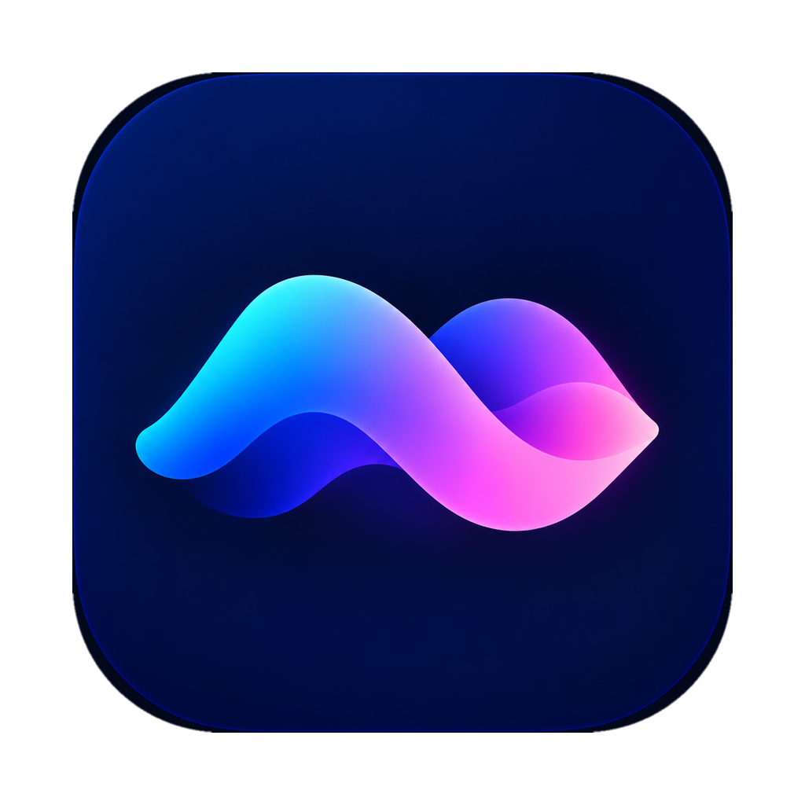
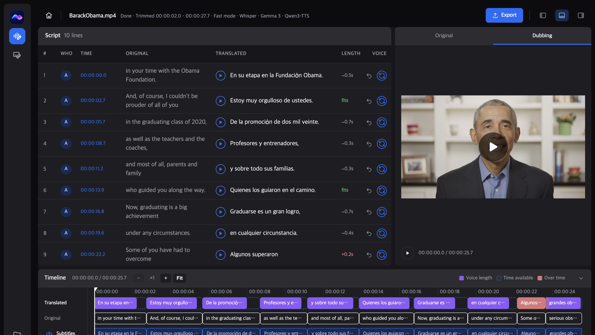
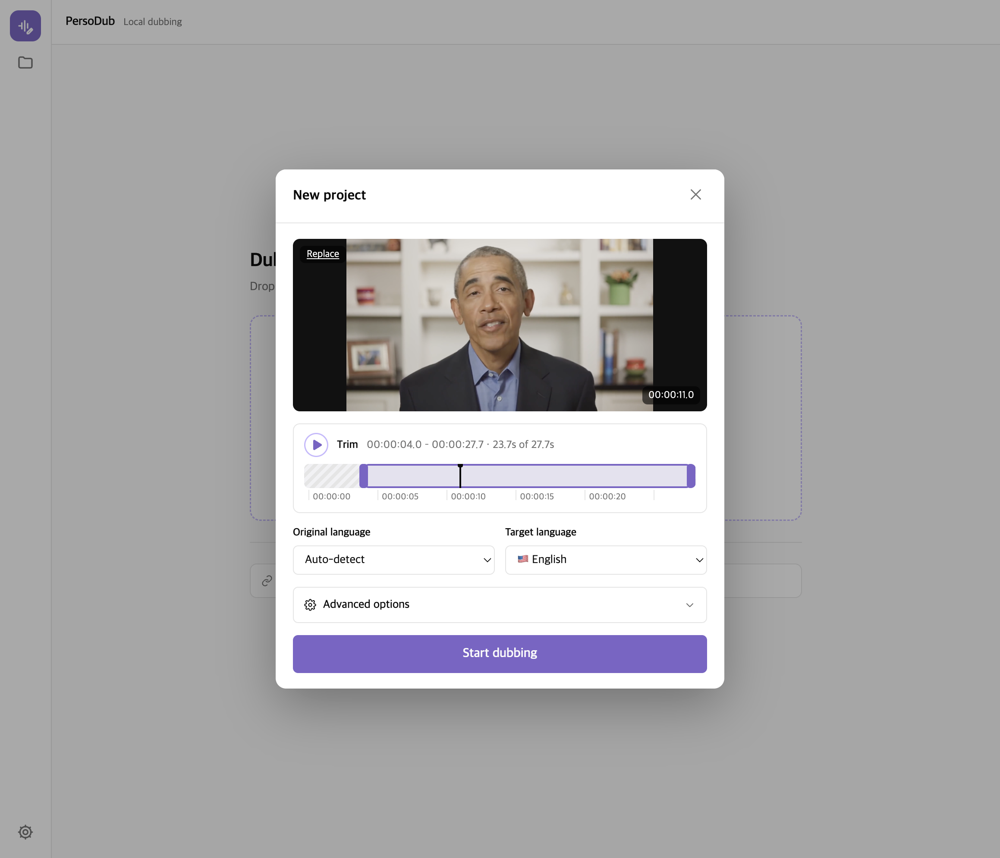
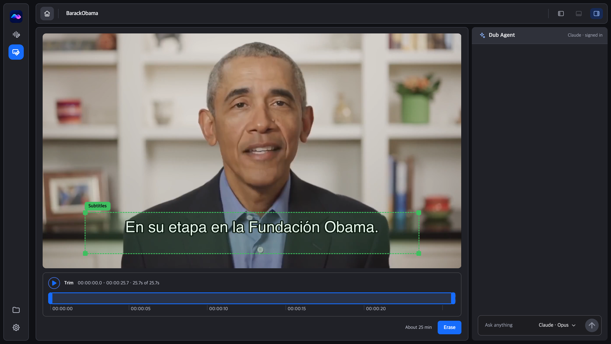
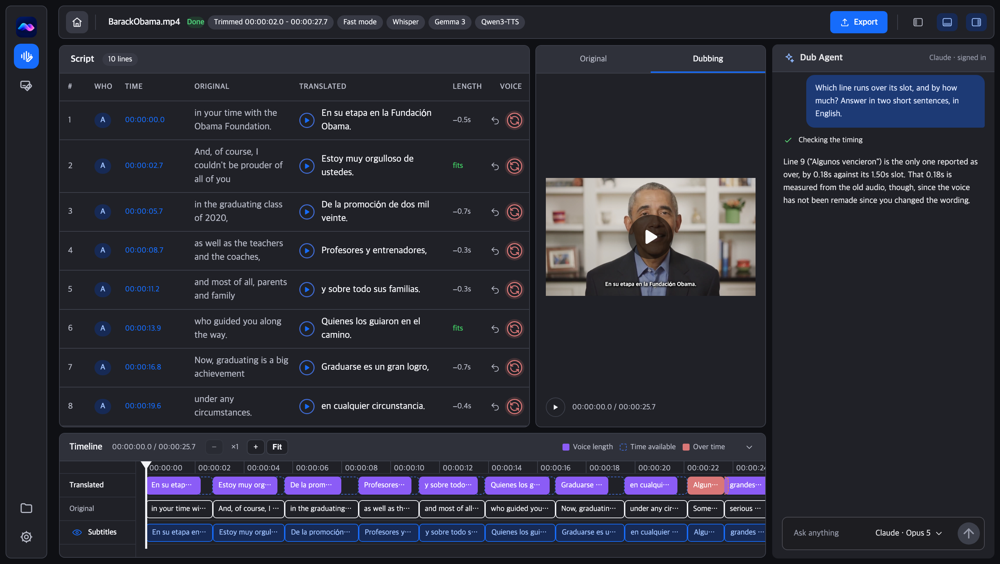

<p align="center">
  
</p>

<h1 align="center">PersoDub</h1>

<p align="center"><strong>Natural dubbing from the best open models.</strong></p>

<p align="center">
  <a href="#get-started">Download</a> ·
  <a href="#hear-the-difference">Hear the difference</a> ·
  <a href="docs/usage.md">How to use it</a> ·
  <a href="docs/faq.md">FAQ</a> ·
  <a href="https://github.com/stronghamjji/PersoDub/issues">Report a problem</a>
</p>

<p align="center">
  <a href="LICENSE"></a>
  <a href="docs/requirements.md"></a>
  <a href="https://github.com/stronghamjji/PersoDub/releases"></a>
  <a href="docs/privacy.md"></a>
</p>

<p align="center">
  <a href="https://github.com/stronghamjji/PersoDub/releases/latest/download/PersoDub-1.0.0-arm64.dmg"></a>
  <a href="https://github.com/stronghamjji/PersoDub/releases/latest/download/PersoDub-Setup-1.0.0.exe"></a>
</p>

<p align="center">
  
</p>

<p align="center">Drop in a video. Clone the voice. Dub it. Fix any line. Post it to Shorts, TikTok or Reels.<br>Open-source, in each speaker's own voice, on your own computer: the ElevenLabs, HeyGen and Rask AI alternative you run yourself.</p>

---

## What it does

<table>
<tr>
<td width="50%" valign="top">



### Dub

One video in, one dubbed video out, in each speaker's own voice. 10 languages on your computer, 100+ with the Perso API, depending on the dubbing model.

</td>
<td width="50%" valign="top">



### Erase burned-in subtitles

Box the subtitles, press **Erase**, and dub the clean video.

</td>
</tr>
<tr>
<td width="50%" valign="top">


### Burn in subtitles

Put a subtitle file on a video in the look you choose.

</td>
<td width="50%" valign="top">



### Fix every line

Edit a line by hand, or tell the **Dub Agent** "make line 2 fit". Only that line is remade.

</td>
</tr>
</table>

## Hear the difference

Same clip, English → Korean, each tool cloning the speaker's voice. The third video plays VideoLingo, KrillinAI, Voice-Pro and VoiceStudio one after another, each named at the top.

<table>
<tr>
<td width="33%" align="center"><b>Original (English)</b></td>
<td width="33%" align="center"><b>PersoDub (Ours)</b></td>
<td width="33%" align="center"><b>Other tools</b></td>
</tr>
<tr>
<td width="33%">

https://github.com/user-attachments/assets/39589651-83fe-4673-91b4-fa078f0e523e

</td>
<td width="33%">

https://github.com/user-attachments/assets/c5b3e0a6-de2a-4026-bdcd-9b3c0f8d179a

</td>
<td width="33%">

https://github.com/user-attachments/assets/d6da4598-1f27-4eeb-8f23-5988a6582daa

</td>
</tr>
</table>

Listen for pacing: PersoDub fits the translation to the time instead of speeding the voice up, and plays a line faster (10% at most) only when it would run into the next one. The source files live in [docs/demo](docs/demo): [VideoLingo](https://github.com/Huanshere/VideoLingo), [KrillinAI](https://github.com/krillinai/KrillinAI), [Voice-Pro](https://github.com/abus-aikorea/voice-pro), [VoiceStudio](https://github.com/debpalash/VoiceStudio).

## Get started

1. Download for [macOS](https://github.com/stronghamjji/PersoDub/releases/latest/download/PersoDub-1.0.0-arm64.dmg) or [Windows](https://github.com/stronghamjji/PersoDub/releases/latest/download/PersoDub-Setup-1.0.0.exe).
2. Drop in a video, or paste a link.
3. Pick a language and press **Start dubbing**.

**Updating from 0.8.4 or earlier?** Download and install the latest version once. From 0.8.5 on, PersoDub updates itself.

Start dubbing uses this computer by default and needs no key. Speech-to-text uses Whisper unless you choose Perso API, and on a new install translation uses ChatGPT through your own sign-in. To keep everything on your computer, set **Translation**, under **Dubbing step settings**, to **Hunyuan** or **Gemma 3**. To dub with the Perso API instead, save a free [Perso API key](docs/configuration.md) and set **Choose a model** to **Perso API**.

First setup is under 1 GB. A Perso API dub downloads nothing more. The first dub on this computer downloads Python + PyTorch and the models: about 10 GB on a Mac, 17 GB on a Windows PC with an NVIDIA GPU, 9 GB without one. A local translator adds 1.6 to 10 GB and the subtitle eraser 4.4 to 9.3 GB, so keep 30 GB free, 40 GB on Windows with an NVIDIA GPU. [Full table](docs/requirements.md)

<details>
<summary>Install notes</summary>

**macOS** — Open the `.dmg` and drag **PersoDub** into Applications. It is signed and notarized, so it opens with a normal double-click, and it checks for updates on launch.

**Windows** — Run the `.exe`. It installs for your user account only. It is not code-signed yet, so SmartScreen shows "Windows protected your PC" the first time: click **More info**, then **Run anyway**. [Details](INSTALL.md#windows).

A screen-by-screen walkthrough is in [docs/usage.md](docs/usage.md).

</details>

### Install with your AI assistant

Paste this into Claude Code, Codex or any coding agent.

```text
Install PersoDub on this computer and check that it works.
Repository: https://github.com/stronghamjji/PersoDub

1. Check my OS, CPU, memory, free disk and GPU. PersoDub needs an Apple Silicon Mac
   or 64-bit Windows 10/11 and 30 GB of free disk (40 GB on Windows with an NVIDIA GPU);
   16 GB of memory is recommended, and dubbing on this computer needs at least 8 GB.
   If this computer falls short, say so and stop.
2. Install the latest release for my OS:
   https://github.com/stronghamjji/PersoDub/releases/latest
   On Windows, SmartScreen warns (not code-signed yet): More info, then Run anyway.
3. Open PersoDub and wait for the first setup (under 1 GB).
4. Start dubbing uses this computer by default and needs no key. Ask me if I want
   a free Perso API key, for better transcription or the Perso API. If yes, open
   https://perso.ai/dubbing?utm_source=desktop_app_github&utm_medium=desktop-app&utm_campaign=desktop_app&utm_content=install_prompt
   then open PersoDub's Settings so I can paste the key in myself. Never ask to see it.
   For a Perso API dub, set Choose a model to Perso API.
5. Dub one video under a minute with me. Before a first dub on this computer, tell me
   the download size (9-17 GB).
   If I pick ChatGPT for translation, I sign in myself. A free account is enough.
6. Report the version, where projects are saved, and how to reopen the app.
Finish the setup, not just a plan. Tell me any step you could not do.
```

## Why PersoDub

- **Your footage can stay yours.** PersoDub dubs on this computer by default. With Whisper and a local translator, none of it leaves. The Perso API, if you choose it, uploads the video.
- **Fix any line after the dub.** Change the words, the speaker or the voice of one line and only that line is remade. Cut on the timeline, or tell the Dub Agent what to fix.
- **Fits the words to the time.** Other tools speed the audio up. On this computer, PersoDub fits the translation instead, and speeds a line up (10% at most) only when it would run into the next one.
- **Voice cloning, not narration.** Each speaker still sounds like themselves.
- **Everything else is kept.** Music and effects stay. The translated `.srt` comes with the video, or burn it in, in the look you pick with **Subtitle style**.

## Details

| | |
|---|---|
| **Requirements** | Apple Silicon Mac or 64-bit Windows · 16 GB memory recommended · 30 GB free disk, 40 GB on Windows with an NVIDIA GPU. [Full table](docs/requirements.md) |
| **Languages** | 10 on your computer, 100+ with the Perso API, depending on the dubbing model. [Full list](docs/languages.md) |
| **Translation** | A local model, or ChatGPT for free. No subscription. [Configuration](docs/configuration.md) |
| **Better quality** | A free Perso key: better transcription, less to download. [Configuration](docs/configuration.md) |
| **Privacy** | By default the video is dubbed on this computer. With Whisper and a local translator, it stays here; the Perso API, if you choose it, uploads it. [What is sent](docs/privacy.md) |
| **How it works** | The Perso API, or on your computer: Mel-Band RoFormer or Demucs, Whisper, CAM++, a local LLM or ChatGPT, Qwen3-TTS. [Architecture](docs/architecture.md) · [Pipeline](docs/architecture.md#2-the-dubbing-pipeline) · [Comparison](docs/comparison.md) · [Roadmap](docs/roadmap.md) |
| **Build from source** | [INSTALL.md](INSTALL.md) · [Development](docs/development.md) · [Contributing and security](docs/contributing.md) |
