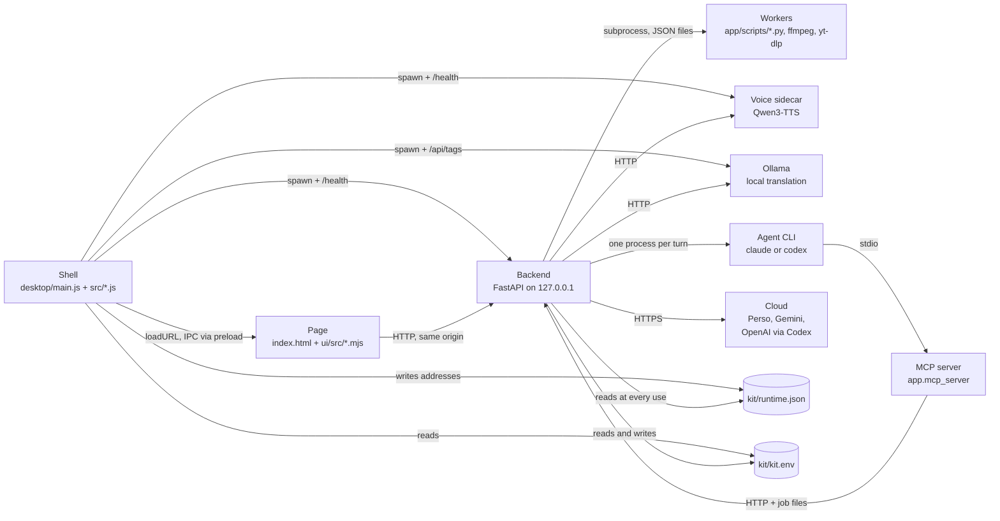
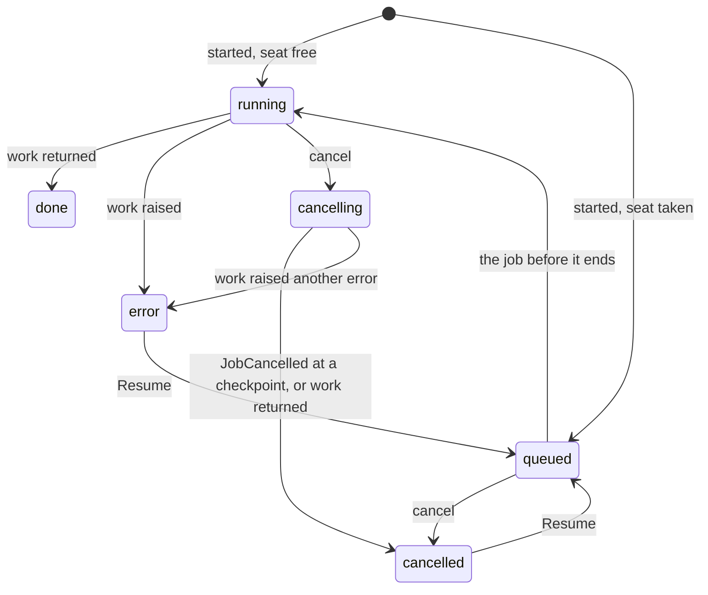
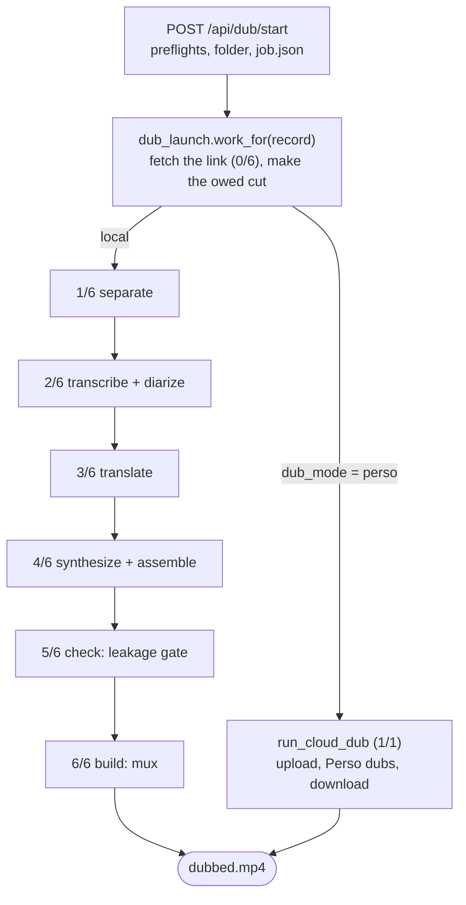

# Architecture

This is how PersoDub is put together: what runs where, how a video moves
through the dubbing pipeline, how the code is layered, where it is meant to be
extended, which interfaces other programs rely on, and what keeps all of that
from breaking. It is written from the code as it stands after the October 2026
refactor. Where the code is ambiguous or uneven, the document says so (see
[Known rough edges](#8-known-rough-edges)) rather than describing an ideal.

Setup, environment variables and the test commands are in
[Development](development.md); what leaves the computer is in
[Data and privacy](privacy.md).

**Contents:**
[1. What runs where](#1-what-runs-where) ·
[2. The dubbing pipeline](#2-the-dubbing-pipeline) ·
[3. Module map](#3-module-map) ·
[4. Extension points](#4-extension-points) ·
[5. Contracts](#5-contracts) ·
[6. Quality gates](#6-quality-gates) ·
[7. How we write code here](#7-how-we-write-code-here) ·
[8. Known rough edges](#8-known-rough-edges)

| Term | Meaning |
|---|---|
| **shell** | The Electron app in `desktop/`: installs the kit, starts the processes, owns the window. |
| **backend** | The FastAPI app in `app/`, bound to `127.0.0.1`. Everything the page does goes through it. |
| **page** | `static/index.html` with `static/css/` and the ES modules in `ui/src/`, served by the backend. |
| **kit** | The folder the shell installs into: interpreters, models, `kit.env`, the backend's code and the user's jobs. |
| **pack** | An optional part of the kit installed on demand: `engine` (the AI engines venv and Demucs), `ollama-runtime`, `subtitle-eraser`. |
| **job** | One unit of background work (a dub, a subtitle erase, a separation) with a record, a folder and a log. |
| **stage** | One of the six steps of a local dub, numbered `N/6` in the job log. |
| **sidecar** | The Qwen3-TTS voice server, a separate process the shell starts. |

## 1. What runs where

### 1.1 Processes

| Process | What it is | Started by | Lives |
|---|---|---|---|
| Shell | Electron main process: `desktop/main.js` (composition root) and `desktop/src/*.js` | the user | until quit |
| Page | Chromium renderer showing the page, loaded from the backend's URL | shell (`win.loadURL`) | the window |
| Backend | `uvicorn app.main:app --host 127.0.0.1 --port <port>` from `<kit>/app_venv`, working directory `<kit>/app` | shell (`orchestrator.js startEngines`) | until quit |
| Workers | `app/scripts/*.py` in their own interpreters; `ffmpeg`/`ffprobe` from `<kit>/bin`; `python -m yt_dlp` | backend, one subprocess per task | one task |
| Voice sidecar | Qwen3-TTS HTTP server, `desktop/vendor/sidecar/server.py` copied to `<kit>/sidecar`, run by uvicorn from `<kit>/engines_venv` | shell, when the `engine` pack is installed | until quit; restarted on request |
| Ollama | `<kit>/ollama/ollama serve`, models in `<kit>/models/ollama` | shell, when the `ollama-runtime` pack is installed | until quit |
| Agent CLI | Claude Code (`claude`) or Codex (`codex`): the user's own install, or the Codex copy `app/codex_fetch.py` puts in `<kit>/codex` | backend: one process per Dub Agent turn, and one `codex exec` per ChatGPT translation request | one turn or request |
| MCP server | `python -m app.mcp_server` over stdio, with `PERSODUB_API` set to the backend's URL | the agent CLI, from the `persodub-mcp.json` the backend writes for it | one turn |

The worker interpreters come from `kit.env`: `SEP_PYTHON`, `STT_PYTHON`,
`DIAR_PYTHON`, `QWEN_SCORER_PYTHON` and `NONVERBAL_WHISPER_PYTHON` all point at
`<kit>/engines_venv`; `ERASER_PYTHON` points at `<kit>/venv-eraser`. Heavy
libraries (torch, onnxruntime, faster-whisper) are never imported by the
backend itself, so a worker that crashes fails its stage, not the app.

Outside the computer:

| Service | Used for | Called from |
|---|---|---|
| Perso API | separation, transcription, whole-video dubbing, editing a Perso dub; the list of Perso languages, at most once a day while a key is saved | `app/perso_client.py`; `app/languages.py` calls the languages endpoint itself |
| Google Gemini / Vertex AI | translation with an API key or a service account | `app/translate.py` |
| OpenAI, through the Codex CLI | ChatGPT translation; the Codex Dub Agent | `app/translate.py`, `app/agents/codex.py` |
| Anthropic, through Claude Code | the Claude Dub Agent | `app/agents/claude.py` |
| Hugging Face, GitHub, PyPI (and PyTorch's own index on Windows), Ollama's registry | install steps and on-demand model downloads | `desktop/src/installSpec.js`, `app/models.py` |
| npm's registry | the Codex CLI for ChatGPT sign-in, on a computer that has none | `app/codex_fetch.py` |
| The site a pasted link points to; PyPI | reading and fetching the video with yt-dlp; a newer yt-dlp, installed with pip when a fetch fails for a reason other than the network | `app/source_fetch.py` |
| GitHub Releases | auto-update (packaged builds) | `desktop/src/updateFlow.js` (electron-updater) |
| Two Cloudflare Workers | usage counts and failure reports, each switchable off in Settings | `desktop/src/usageIpc.js`, `desktop/src/reporting.js`; the report relay's code is `relay/`, the count worker's is not in this repository |

**Editions.** The same code builds two editions that
differ in where a dub runs when nothing is chosen: open source (the
default) dubs on this computer, production dubs with the Perso API. Both
point at the same repository, `stronghamjji/PersoDub`.
The repository decides the update feed, the page's GitHub and Send
feedback links, the Help window's User guide and FAQ, and the update
window's release-notes link. `PERSODUB_EDITION` picks the edition when the
payload is collected, and `scripts/collect-payload.mjs` writes it into the
payload's `EDITION` file. At launch `desktop/src/edition.js` reads that file
(the environment cannot override it; without the file, as in `npm start`, it
reads `PERSODUB_EDITION`), `updater.js resolveFeed` sets the feed from it,
and the window passes the repository to the page as `persodubShell.repo`.
The kit remembers the edition it first ran as in `kit.env`
(`rememberedEdition`), so an update from the public releases keeps it.
The shell also hands the edition to the backend as `PERSODUB_EDITION`
(`desktop/src/orchestrator.js startEngines`), and `app/setup.py` makes Perso's
cloud the dub default for production only; the open-source edition, and a
backend run without the shell, dub on this computer. The remembered edition
is for that default only: the Perso sign-in and the button events' default
follow the app file's own edition, which the backend gets as
`PERSODUB_BUILD_EDITION`.

### 1.2 The kit and the other folders

The kit is found in this order: `PERSODUB_KIT_DIR`, then `kitDir` in
`desktop/config.json`, then an existing legacy `~/persodub_full_mac`, then the
per-user application-data folder (`~/Library/Application Support/PersoDub` on
macOS, `%LOCALAPPDATA%\PersoDub` on Windows), all in `desktop/src/config.js`.

| Path in the kit | What it holds | Written by |
|---|---|---|
| `kit.env` | the one settings file: interpreter paths, model paths, API keys, dub defaults, switches | installer `kit-env` step; Settings and the Dub Agent through `app/settings_env.py` |
| `KIT_VERSION` | the version of the payload the kit was installed from | installer `payload` step |
| `runtime.json` | where each pack's process listens right now, and its process id | shell (`desktop/src/runtimeFile.js`) |
| `app/` | the backend's code, copied from the bundled payload | installer `payload` step |
| `app/workspace/` | every job folder (`<day>/<project>_<lang>`) and held videos (`downloads/<id>`) | backend (`app/state.py` `WORKSPACE`) |
| `app/logs/` | the Dub Agent's working folders, and `persodub.log` (rotating) and `job-<id>.log` only for a backend run without the desktop app, which keeps them in `<userData>/logs/` (below) | backend (`PERSODUB_LOG_DIR`, default `logs` relative to the working directory) |
| `python/`, `app_venv/` | standalone CPython 3.11 and the backend's venv | installer |
| `bin/` | `ffmpeg`, `ffprobe` (put on the backend's `PATH`) | installer `ffmpeg` step |
| `sidecar/` | the voice server's code | installer `payload` step |
| `engines_venv/` | torch and the engines (Demucs, Whisper, CAM++, Qwen3-TTS) | `engine` pack |
| `models/` | `campplus` (base install), `demucs` (`engine` pack), and `whisper`, `qwen3-tts`, `melband-roformer`, `ollama` (downloaded on demand) | installer; backend catalog downloads (`app/models.py`) |
| `ollama/` | the Ollama binary | `ollama-runtime` pack |
| `eraser/`, `venv-eraser/` | video-subtitle-remover and its venv | `subtitle-eraser` pack |
| `codex/` | the Codex CLI fetched for ChatGPT sign-in | backend (`app/codex_fetch.py`) |
| `chatgpt/` | PersoDub's own Codex home: the app's ChatGPT sign-in, which the ChatGPT translator and the Codex Dub Agent share | backend (`app/agents/base.py` `chatgpt_env`) |
| `.install/` | one `<step>.ok` stamp per finished install step, and an "installing" marker per pack | installer |
| `downloads/`, `reports/` | install archives; failure reports waiting for a network | installer; shell |

Outside the kit, the shell keeps `<userData>/logs/` (`shell.log`, `backend.log`,
`sidecar.log`, `ollama.log`, `pids.json`, the `clean-exit` note, and the backend's
own `persodub.log` and `job-<id>.log`, written there through `PERSODUB_LOG_DIR`,
and `timeline.log`, `shell.log`, `persodub.log` and the job logs merged in time
order by `desktop/src/timeline.js`)
and `<userData>/ports.json`. `<userData>` is Electron's folder for the app, named
after the packaged `package.json`'s `name` (`desktop/electron-builder.js`
sets it per edition):
`~/Library/Application Support/persodub-desktop-shell` on macOS,
`%APPDATA%\persodub-desktop-shell` on Windows, and `perso-desktopapp-shell`
for the production edition, whose kit is in a `PersoDubbing` folder.

### 1.3 Boot

1. `main.js` takes the single-instance lock (a second launch only focuses the
   first window), builds the one window (`windowFactory.js`: context isolation,
   `preload.cjs`, http(s) links handed to the system browser, navigation
   limited to the backend's origin and local files such as the bundled
   `desktop/screens/`), and runs `boot(win)` from `bootFlow.js`.
2. `boot` loads the config, finds the bundled payload (`Resources/payload` in a
   packaged build, `desktop/resources/payload` in a checkout), and renames an
   old `mac.env` to `kit.env`. If the default kit is the legacy
   `~/persodub_full_mac` and it fails the check below, the boot switches to
   the per-user location and carries the old kit's models over.
3. `prepareKit` decides whether to install: `engineCheck.js checkKit` (four
   required files and a matching `KIT_VERSION`) and the installer's own `.ok`
   stamps. When something is missing it checks the Windows path length and the
   free disk first, then runs the base steps plus the steps of packs already on
   disk (`installSpec.js bootSteps`), streaming progress to `installing.html`.
   With no payload at all (a plain `npm start`), only the file check applies.
4. The update check starts (not awaited), then `startApp` shows
   `loading.html` and calls `startEngines` (`orchestrator.js`):
   - kills whatever `pids.json` says the last launch left running;
   - builds the environment: the shell's own, `kit.env` laid over it, `<kit>/bin`
     prepended to `PATH`, and `PERSODUB_CLIENT=desktop`,
     `PERSODUB_APP_VERSION=<desktop/package.json version>`,
     `PERSODUB_LOCALE=<ko|en, the computer's language>` and
     `PERSODUB_LOG_DIR=<userData>/logs` set last;
   - clears the addresses in `runtime.json`, then starts each installed pack on
     a free port, writes its state as `"starting"`, waits for its health
     answer (two minutes of silence at most; the voice engine's "loading"
     answers extend that up to fifteen minutes) and only then writes its
     address and process id. A pack that does not come up is stopped and
     marked `"failed"`; the window still opens, and only local work that
     needs it is refused;
   - starts the backend on last launch's port from `ports.json` when it is
     free (so the page's origin, and its `localStorage`, survive a relaunch)
     and waits up to a minute for `GET /health`.
5. The window loads the backend's URL, the shell logs `PERSODUB_READY`, counts
   the launch and sends any failure reports queued while offline.

The backend's own start-up (`app/main.py` lifespan) configures logging, logs
every unusable setting found by `app/config.py`, reads every `job.json` back
into the job store, re-arms jobs that were queued when the app closed, and,
when ChatGPT is the translator in force and no Codex CLI is installed, starts
fetching one in the background.

### 1.4 How the processes find each other

- **Shell to backend**: the shell picks the port and keeps the URL in
  `ctx.engines.url`. The page is served from that URL, so the page always
  talks to the backend same-origin and never needs to know a port.
- **Backend to packs**: only through `runtime.json` (`app/runtime.py`), read
  fresh at every use, so a pack installed or restarted mid-session is picked up
  without restarting the backend. Inside a kit the environment is deliberately
  not consulted (`kit.env` carries a fixed `QWEN_TTS_URL` line that would make
  a missing engine look present). Outside a kit, a plain uvicorn run, the
  `QWEN_TTS_URL`/`OLLAMA_URL` constants in `app/config.py` apply.
- **Backend to settings**: values that can change while the app runs (API
  keys, dub defaults, the eraser paths, `STT_ENGINE`) are read through
  `settings_env.current_value`, which reads `kit.env` first, every time.
  Everything else comes from the backend's environment as the shell built it
  at launch, mostly read once at import as a constant in `app/config.py`, so
  changing it needs a restart.
- **Page to shell**: only `window.persodubShell`, exposed by `preload.cjs`
  (see [IPC channels](#ipc-channels)). In a plain browser it is absent and the
  page works without it.
- **Agent to backend**: the backend writes `persodub-mcp.json` naming
  `python -m app.mcp_server` and the backend's URL; the CLI starts that server;
  each tool calls the backend's HTTP routes or reads and edits the job's
  script files directly (`app/dub_script.py`).

### 1.5 Restarts and clean-up

| When | What happens |
|---|---|
| The voice sidecar holds more than 10 GB between two lines | `QwenTTSEngine.restart` posts `/restart`; the sidecar exits with code 75 once its line is done; `orchestrator.js` sees the code and starts it again on a new port; the backend waits for `runtime.json` to name a healthy engine and clones the job's voices again |
| A local dub starts and the voice engine is not running | the start route answers 422 with a sentence containing "voice engine is not running"; the page calls `persodubShell.installPack("engine")`, which skips every finished step and restarts the process, then retries once |
| A pack is installed or removed in the app | `shell:install-pack` runs the pack's steps and starts its process (five-minute health wait); `shell:remove-pack` stops it, withdraws its address and deletes its folders and stamps |
| Boot failed | the error screen's Try again sends `shell:retry`, which runs `boot` again (overlapping boots are refused) |
| Settings "Restart now", or an update is ready | `shell:relaunch` / `shell:restart-to-update` |
| Quit | `will-quit` writes the `clean-exit` note and stops every child (process group SIGTERM then SIGKILL after 3 s on POSIX; `taskkill /T /F` on Windows), or kills from `pids.json` when the engines were still starting |
| Any other pack exit | left alone; the next "Start dubbing" restarts it as above |

## 2. The dubbing pipeline

### 2.1 Jobs and their lifecycle

A job has a `kind`: `"dub"` (also what a record with no `kind` means),
`"erase"` or `"separate"`. The job store (`app/jobs.py JobStore`, one
instance in `app/state.py`) keeps each record in memory, mirrors every log line
to `<PERSODUB_LOG_DIR>/job-<id>.log`, and writes the record to `job.json` in
the job's folder (atomically, temp file then rename) when the job is
launched, queued, dispatched and finished, and whenever a step stamps
something that must survive a restart.

Local work runs one job at a time (the store's single "on air" seat), whichever
door it came in through. Work that Perso does entirely on its side (a Perso API
dub, a separation sent to Perso) starts at once beside it
(`parallel=True`) and never holds the seat.

The statuses are these strings, defined in `app/jobs.py`. The page, the MCP
server and `job.json` all compare them as strings, so the values themselves
are the contract:

On restart, a record still `"running"` or `"cancelling"` is read back as
`"error"` with the error `"interrupted"` (its thread died with the process),
and every `"queued"` job is put back in line oldest first, its work rebuilt
from the record alone (`app/api/dub.py rearm_queued_jobs`). That is why each
kind has a builder that reads nothing but the record and the folder:
`app/dub_launch.py`, `app/erase_launch.py`, `app/separate_launch.py`.

A failed job's `error` is what the screen shows: the exception's own sentence
when it is a `RuntimeError` or `ValueError` (the pipeline's user-facing
vocabulary), or "Unexpected error (Type) - see the job log" for anything else,
whose traceback then goes to the job log.

### 2.2 From "Start dubbing" to the pipeline

1. `POST /api/dub/start` (`app/api/dub.py dub_start`) reads the form into one
   plan: blank choices take the saved defaults (`app/setup.py`), and an
   unknown engine name or language code is a 422. Then, before anything is
   saved: enough memory, a translator that can run, the keys the chosen cloud
   stages need, the Perso workspace (all 422 with a sentence), the models and
   packs still missing (409 with `{missing, total_bytes, free_bytes}`, which
   the page turns into "Download N GB to dub?"), and a running voice engine
   (422).
2. After the free-space floor (507, `app/room.py`) it makes the folder
   `WORKSPACE/<YYYY-MM-DD>/<project>_<lang>`, copies in `input.mp4` (an upload
   or a held download, cut to the kept parts; a link is fetched later, inside
   the job) and checks the room the whole job needs (507). Then come the
   optional `sub.srt` (a finished translation) and `source.srt` (a source
   script), and the stems of a matching finished separation job, in which
   case the run starts in resume mode and skips stage 1.
3. `app/api/_launch.py launch_job` makes the record, stamps the engine
   choices on it, writes `job.json`, logs the first line and hands the work to
   the store.
4. The work fetches the link (logged as `0/6 Fetching video… N%`), makes
   the cut the record still owes (recording it in `job.json` the moment it
   lands, so a restart never cuts twice), then calls `run_cloud_dub` for a
   Perso API dub or `app/pipeline.py run_dub` for everything else.

### 2.3 The six stages

The stage table is `app/stages.py STAGES`; every `N/6` log marker is built from
a stage's position in it. The page folds the six into four progress steps.

| # | Stage | Shown as | On this computer | Through Perso or another service | Leaves in the job folder |
|---|---|---|---|---|---|
| 1 | `separate` | Separating audio | Mel-Band RoFormer when its weights are downloaded, else Demucs (`app/separate.py`, a worker under `SEP_PYTHON`) | Perso separation (`sep_engine="perso"`) | `vocals.wav`, `background.wav`, `separated.json` |
| 2 | `transcribe` | Transcribing | Whisper (`app/stt_local.py`, under `STT_PYTHON`), then CAM++ speaker labels (`app/diar_campplus_client.py`, under `DIAR_PYTHON`) | Perso STT with its own speaker labels (`stt_engine="perso"`) | `transcript.json` |
| 3 | `translate` | Translating | Hunyuan, Gemma or Qwen through Ollama | ChatGPT (through the Codex CLI), Gemini, Vertex AI | `original.srt`, `speakers.json`, `translated.srt`, `chatgpt_answers/` |
| 4 | `synthesize` | Dubbing | Qwen3-TTS sidecar (`app/qwen_pipeline.py`) | none | `qwen_ref_<speaker>.wav`, `speaker_refs.json`, `qwen_line_<i>.wav`, `lines.json`, `qwen_dub_48k.wav`, `clipped_lines.json`, `nonverbal_manifest.json` |
| 5 | `check` | Dubbing | `pipeline.leakage_gate`: measures the original voice left under the dub and cancels echo runs (`PERSODUB_LEAKAGE_GATE` `on`/`measure`/`off`); never fails the dub | none | `dub_leakfix.wav`, only when it rewrote the mix |
| 6 | `build` | Dubbing | ffmpeg mux, length check, then the losing takes are deleted | none | `dubbed.mp4` |

In more detail:

- **Transcribe** moves each line's start to where its speech really begins on
  the vocals track (`app/audio/onset.py`), for Perso's lines and Whisper's
  alike. Only Whisper's lines get CAM++ labels; Perso labels its own.
- **Translate** sends the source lines (or the user's `source.srt`) to the
  job's translator. Every translator that can follow a length rule is asked to
  land each line within ±15% of its time slot and is re-asked for the lines
  that miss (`app/text/length_fit.py`); a line that comes back in the wrong
  script is asked again, except from ChatGPT, whose wording stands.
  `translated.srt` is written whole or not at all. A job given a
  finished translation (`sub.srt`) skips the translator and only records the
  script files.
- **Synthesize** picks a 4-7 s reference clip per speaker, clones each voice
  once, and makes every line: once in Fast mode, where an engine with free
  retakes hears each line back and makes the wrong ones again; or N times in
  High quality, where a worker scores the takes and the winner is copied to
  `qwen_line_<i>.wav`. In Fast mode, when the app translated the script
  itself, lines that end well short of their slot or run well past it are
  written again for the speaker's measured pace and voiced again
  (`app/text/pace_fit.py`). Each line's loudness is matched to the original
  and each starts where its cue starts; a line that would run into the next
  is played up to 10% faster (`QWEN_MAX_SPEEDUP`, pitch kept) and then cut,
  and the cut is recorded in `clipped_lines.json`. The lines are laid over the
  background as `QWEN_GATE_MODE` says (default `safe`: the original vocals are
  never mixed in, except laughs and breaths a Whisper check finds free of
  words).

Other files a job folder may hold: `job.json`, `input.mp4`, `sub.srt`,
`source.srt`; High-quality takes `qwen_line_<i>_t<k>.wav` (deleted at stage 6)
and the scorer's `qwen_scorer_input.json`/`qwen_scorer_output.json`; Fast-mode
extra takes and retries (`qwen_line_<i>_s<k>.wav`, `_r<n>.wav`, `_pace.wav`,
`pace_fit.json`); the separation worker's `sep_input.json`/`sep_output.json`;
the finished screen's own files (`edited.srt`,
`voice_texts.json`, `subtitle_style.json`, `view.json`); and picture caches
(`thumb.jpg`, `input.mp4.filmstrip.jpg`, `input.mp4.waveform.json`). The
per-line voices, the background and the speaker references are kept on
purpose: re-speaking a single line needs all three.

A **Perso API dub** (`dub_mode="perso"`, the production edition's default when nothing is chosen) runs none of the six: it logs
`1/1 Dubbing in the Perso cloud…`, uploads `input.mp4`, lets Perso
translate and voice it, and downloads `dubbed.mp4`; the Perso project and
workspace numbers go on the record so its script can be opened later
(`app/perso_materialize.py`, `app/perso_edit.py`). A local dub can still
send its separation or transcription to Perso. Either way a Perso failure
fails the job with a sentence that names the stage and carries Perso's
reason; no stage silently falls back to a different engine.

### 2.4 Resume

`POST /api/dub/jobs/{id}/resume` accepts a dub that is `"error"` (including
`"interrupted"`) or `"cancelled"`, is not a Perso API dub, and still has its
`input.mp4`. It claims the job back to `"queued"` and runs `run_dub` with
`resume=True` in the same folder, with the same choices. A stage's result is
reused only while every stage before it was reused too, because a stage made
again can change the lines:

| Stage | Reused when |
|---|---|
| separate | `separated.json` names two usable files (over 44 bytes) inside this folder |
| transcribe | separation was reused and `transcript.json` holds cues |
| translate | transcription was reused, no `sub.srt` was given, and `translated.srt` exists |
| synthesize | translation was reused or `sub.srt` was given: each line (or take) file already on disk is kept and only the missing ones are made |
| check, build | always run again |

A Perso stage leaves its result in the same files, so a resume never pays
Perso twice, and ChatGPT answers are cached per prompt in `chatgpt_answers/`.
A resume may name another translator only while the translation is not done.

The other ways to make a job again: **Try again** (`/retry`, a new job from
the saved `input.mp4` with the same choices), **redub** (`/redub`, a new job
that only makes the voices, from the script as edited, `voices_only` on the
record), **Add language** (`/again`, which starts nothing: it holds the video
again for a new draft), and the edits of a finished dub, which
run in the request rather than as a job: re-speaking one line
(`qwen_pipeline.resynth_one_line`, then `rebuild_dub` re-mixes and re-muxes
in place), remaking every changed line, and translating chosen lines again
(`app/retranslate.py`).

### 2.5 Cancellation

`POST /api/dub/jobs/{id}/cancel` serves every kind. A queued job is
cancelled at once. A running one becomes `"cancelling"`; nothing is killed,
and the work stops at its next checkpoint, where
`jobs.raise_if_cancelled` logs `Cancelled by user request` and raises
`JobCancelled`. The checkpoints:

- before stage 1 and between every two stages (`run_dub`'s `checkpoint()`,
  which also stops the job when the rest of it will not fit on the disk);
- before every translator request (`TranslationEngine.before_ask`);
- between voice lines and between pace-fit rounds (`app/qwen_pipeline.py`);
- inside Perso's progress polling (`PersoClient.cancel_check`), the link
  download (`app/source_fetch.py`) and the subtitle eraser (`app/eraser.py`);
- after the separation of a Separate audio job.

Whatever is in flight at that moment (one sidecar request, one worker run)
finishes first.

## 3. Module map

### 3.1 Backend (`app/`)

| Layer | Modules | Notes |
|---|---|---|
| HTTP | `app/main.py`; `app/api/*.py`, one router per area: `agent`, `clips`, `downloads`, `dub`, `erase`, `media`, `misc`, `models`, `report`, `results`, `script`, `separate`, `settings`, `thumbs`, `view`; `app/api/_launch.py` (the start every job route shares: `check_space`, `job_dir`, `today`, `missing_models`, `raise_models_needed`, `require_perso_workspace`, `launch_job`, `goes_beside_the_line`); `app/api/_shared.py` (where a job's folder is, file naming, the trim and kept-parts rules) | The only modules that import FastAPI. `main.py` holds the app, the host allow-list and the cross-origin write guard, the page, `/js/{name}`, `/css/{name}`, `/health`, and the router list. |
| Application services | `app/pipeline.py` (`run_dub` and its stages), `app/qwen_pipeline.py` (the voice stage, line remakes), `app/dub_launch.py`, `app/erase_launch.py`, `app/separate_launch.py` (a job's work from its record), `app/jobs.py`, `app/state.py` (`WORKSPACE`, the one `job_store`), `app/dub_script.py`, `app/retranslate.py`, `app/perso_materialize.py`, `app/perso_edit.py`, `app/downloads.py` (held videos) | Nothing here knows about a request. Routers call in; services never import `app.api`. |
| Domain logic | `app/text/*` (subtitles, cues, prompts, length and pace fitting, numbers, naming), `app/audio/*` (PCM, wav I/O, time spans, short-line merging, onsets, stray sounds, ambience), `app/qwen_assemble.py` (placement, gains, gating), `app/qwen_select.py`, `app/nonverbal.py`, `app/subtitle_ass.py`, `app/stages.py`, `app/room.py`, `app/languages.py`, `app/report_mask.py`, `app/run_errors.py`, `app/timeouts.py` | Mostly pure. `app/stages.py`, `app/report_mask.py` and `app/audio/pcm.py` import nothing from the app. |
| Adapters | `app/perso_client.py`, `app/translate.py`, `app/engines/*`, `app/media.py` (ffmpeg; imports only `app/timeouts.py`), `app/media_preview.py`, `app/ratio.py`, `app/source_fetch.py` (yt-dlp), `app/models.py` (model catalog and downloads), worker bridges (`app/separate.py`, `app/stt_local.py`, `app/diar_campplus_client.py`, `app/qwen_scoring.py`, `app/eraser.py`), `app/codex_fetch.py`, `app/agents/*` (CLI drivers), `app/mcp_server.py` | The only places that speak to another program or service. |
| Configuration and runtime | `app/config.py` (environment constants; bad values recorded in `CONFIG_ERRORS` instead of raising), `app/settings_env.py` (`kit.env`), `app/setup.py` (per-stage defaults), `app/runtime.py` (`runtime.json`), `app/engines_status.py` (what can run here now), `app/logging_setup.py` | Read at use time where a value can change while the app runs. |
| Workers | `app/scripts/*.py`: `demucs_separate`, `roformer_separate`, `whisper_transcribe`, `campplus_diarize`, `campplus_embed_files`, `qwen_score_takes`, `erase_subtitles`, `suggest_area` | Run in their own interpreters, JSON in and JSON out. `check_leakage`, `suppress_vocal_echo` and `check_speaker_identity` are imported by the backend and also run as command-line checks. |

### 3.2 Page (`static/`, `ui/src/`)

`static/index.html` is markup plus two small module blocks: one imports
`ui/src/app.mjs`, the other starts the Dub Agent strip. `static/css/app.css`
and `static/css/agent.css` are its stylesheets. `ui/src/` is flat:

| Group | Modules |
|---|---|
| Composition root | `app.mjs`: imports every screen, wires them together in page order (the order is behaviour), owns the page state |
| API layer | `dubApi.mjs`: form building, polling, progress parsing, the stage table, engine labels |
| Screens | `homeScreen`, `homeSidebar`, `projects`, `runningScreen`, `eraseScreen`, `eraseArea`, `draftSetup`, `draftImport`, `importBlock`, `newProject`, `newProjectWindow`, `workFrame`, `leftTabs`, `languageRow` |
| Finished-dub editor | `scriptTable`, `scriptWatch`, `timeline`, `cutTools`, `trimBar`, `donePlayer`, `playerFoot`, `playRange`, `subtitleOverlay`, `subtitleLayout`, `captionsTab`, `ratio`, `speakers` |
| Dialogs | `settingsDialog`, `modelsDialog` + `modelsUi`, `keyWindow`, `chatgptSignIn`, `chatgptSetup`, `confirmDialogs`, `exportDialog`, `updateWindow`, `whatsNew`, `translatorChoice` |
| Small state | `draft`, `keptDrafts`, `rememberedChoices`, `reportedOnce`, `pendingSave` |
| Shared helpers | `format`, `icons`, `linkField`, `escapeKey`, `persoModels` |
| Dub Agent | `agentStrip.mjs`, started by its own block so the feature stays removable |

A screen module exports `initX({ $, ...what it needs })`, taking the element
lookup and callbacks rather than reaching for globals, and returns what the
rest of the page may call. Logic that needs no DOM is exported as plain
functions, so each module's `*.test.mjs` runs under `node:test` with nothing
else present.

### 3.3 Shell (`desktop/`)

| Group | Modules |
|---|---|
| Composition root | `main.js`: single-instance lock, the shared `ctx`, wiring, the four IPC channels it answers itself, quit |
| Boot and install | `bootFlow`, `config`, `engineCheck`, `installSpec` (every step, the packs, the `kit.env` template), `installer` (step runner with resume and retry), `download`, `extract`, `exec`, `ollamaPull`, `kitEnv`, `platform` |
| Processes | `orchestrator` (start, health, restart, stop), `runtimeFile`, `health`, `freePort`, `cleanExit` |
| Window and IPC | `windowFactory`, `zoomReset`, `downloadsIpc` + `downloadPath` + `revealPolicy`, `packIpc`, `usageIpc` |
| Updates | `updateFlow`, `updater`, `lockCheck`, `edition` (which repository the build points at, see [Editions](#editions)) |
| Counts and failure reports | `analytics`, `reporting`, `report`, `reportLogs`, `reportQueue` |
| Shared | `errorText` |

Beside them: `preload.cjs` (the page's only door into the shell),
`screens/` (the loading, installing, error and not-installed pages),
`fake/` (a fake backend and sidecar for `PERSODUB_FAKE=1` and the smoke
tests), `scripts/collect-payload.mjs` (gathers the payload a build bundles:
the app code, the sidecar, the requirement files, `KIT_VERSION`, `EDITION`), and
`vendor/` (the sidecar, the CAM++ model, and the requirement files of the
engines and eraser venvs).

### 3.4 Everything else

`tests/` is the Python suite (`conftest.py` points `WORKSPACE` and the log
folder at a temporary directory for every test); `ui/testlib/` holds the
page-reading helper and the stand-in DOM; `relay/` is the failure-report
Cloudflare Worker; `.github/workflows/` holds CI and the Windows build and
release jobs.

## 4. Extension points

### 4.1 Translators

`app/translate.py TranslationEngine` is what every translator is. A
translator declares what it can do instead of being probed for it, and the
pipeline and the length passes read those declarations:

| Attribute | Meaning |
|---|---|
| `id`, `display_name`, `model` | names for the job log |
| `max_budget_retries` | rounds of re-asking a line outside its ±15% length window (3 local, 1 ChatGPT, 0 paid Google) |
| `recheck_script` | ask again when a line comes back in the wrong script (off for ChatGPT, whose choices stand) |
| `length_rules` | whether it is given character budgets at all (off for a model that cannot follow them) |
| `plain_lines` | a translation-only model asked one line at a time in plain words (Hunyuan) |
| `format_tries` | how many times an unreadable answer is asked again |
| `answers_dir` | set by the pipeline; a translator that caches answers (ChatGPT) keeps them there |
| `before_ask` | set by the pipeline to its cancel check; `ask()` runs it before every request |

Every request goes through `ask(prompt)`, which runs `before_ask` and then the
subclass's `_ask`. `translate(texts, target_lang, source_lang, durations,
fuller)` returns one line per input, with `UNTRANSLATED` (an empty string)
for a line that could not be answered. Today's translators are `GeminiTranslator`,
`VertexTranslator`, `ChatGptTranslator` and `OllamaTranslator` (one class for
the Qwen, Gemma and Hunyuan models).

Two tables are keyed by the same names. `translate.TRANSLATORS` maps a name to
a factory, and `get_translator(name)` builds from it (an unknown name gets
Ollama's default model). `engines_status.TRANSLATORS` is a table of
`TranslatorInfo` descriptors, what the app knows before a dub: its label,
its kind (`"account"`, `"key"` or `"ollama"`), a `probe` that asks the
machine now, the refusal sentence, its catalog model, whether Settings offers
it, whether it needs extra memory beside the voice engine, and whose money it
spends. The descriptors drive the Settings choices (`app/setup.py`), the start
and resume preflights, the memory check (`app/room.py`) and the Dub Agent's
`set_default`.

**To add a translator:**
1. Subclass `TranslationEngine` in `app/translate.py`: declare the attributes
   above, implement `_ask` and `translate` (most reuse
   `_translate_with_fallback`), and send every request through `self.ask`.
2. Give account-level failures their own `RuntimeError` subclass with a
   sentence for the user, and add them to `_NOTICE_ERRORS` and the translate
   stage's `_GEMINI_NOTICE_ERRORS` tuple in `app/pipeline.py` (despite its
   name it already holds the ChatGPT errors).
3. Add the factory to `translate.TRANSLATORS` and a `TranslatorInfo` to
   `engines_status.TRANSLATORS`. A downloaded model also needs a catalog entry
   in `app/models_catalog.json` and a model-tag setting in `app/config.py`.
4. The page keeps its own lists: the `#translateSelect` options in
   `static/index.html`, `ENGINE_LABELS` in `ui/src/dubApi.mjs`,
   `ui/src/translatorChoice.mjs`, `ui/src/modelsUi.mjs` for a local model, and
   an `<name>_available` field in `GET /api/engines` if it should be greyed
   out.
5. Extend `tests/test_translator_preflight_matrix.py` with its rows, and test
   the class with `_ask` faked.

### 4.2 Voice engines

`app/engines/base.py TTSEngine` is the voice socket. The voice stage reaches
an engine only through these members:

| Member | Meaning |
|---|---|
| `id`, `display_name`, `log_name` | registry id and names |
| `supports_cloning` | can make a voice from a reference clip |
| `needs_spoken_numbers` | is handed numbers written out as words |
| `adds_stray_sounds` | a short sound before a line may need cutting |
| `free_retakes` | a retake costs only local time, so Fast mode hears every line back, retakes short lines and rewrites lines to the speaker's pace |
| `is_available()`, `synthesize(SynthesisRequest) -> SynthesisResult` | the essentials: wav bytes for one line |
| `clone()`, `assign_voices()` | one voice per speaker for a job; the default clones each reference once |
| `memory_mb()`, `restart()`, `device_label()` | optional; the voice stage restarts an engine holding too much memory |

Failures are typed: `SynthesisTimeout` and `SynthesisCut` fail one line,
`VoiceEngineDown` stops the job with a notice.
`app/engines/__init__.py` registers `QwenTTSEngine` (`qwen3_tts`) in the
registry; `get_engine`, `list_engines` and `register_engine` live in
`base.py`.

**To add a voice engine:**
1. Subclass `TTSEngine` in `app/engines/<name>.py`, set the flags honestly
   and raise the typed errors; read any service address at every use, the way
   `QwenTTSEngine.base_url` reads `runtime.json`.
2. Register it in `app/engines/__init__.py` (this serves `/api/tts/engines`,
   `/api/tts/say` and line remakes).
3. Wire the job's word for it, because the pipeline does not look engines up
   in the registry: add it to the `voice` choices in `app/setup.py STAGES`;
   let the voice checks of the start, retry and redub routes in
   `app/api/dub.py` (`_require_voice_engine_running`, and `missing_models`,
   which asks for the Qwen3-TTS model) skip what it does not need; hand the
   job's `tts` from `app/dub_launch.py work_for` through `run_dub` to
   `app/pipeline.py _stage_synthesize`, which builds the engine, and to
   `resynth_one_line` in `app/qwen_pipeline.py`; add its refusals to
   `pipeline._NOTICE_ERRORS` and its availability to `app/engines_status.py`
   and `GET /api/engines`.
4. On the page: `#voiceSelect` in `static/index.html` and `ENGINE_LABELS` /
   `voiceLabel` in `ui/src/dubApi.mjs`.
5. Test it against a fake transport, and the voice stage with a fake engine
   (`tests/test_qwen_pipeline.py`, `tests/test_engines_registry.py` show the
   shape).

### 4.3 The Perso client

`app/perso_client.py PersoClient` is how the app talks to Perso. (The one call
made outside that module is the language list: `app/languages.py` asks Perso's
languages endpoint for it at most once a day while a key is saved, with the same
identity headers.) It takes the key (`PERSO_API_KEY`) from `kit.env`, falling back to the
environment, and the workspace from `PERSO_SPACE_SEQ` or, when none is
pinned, from the key itself. Every call
carries the app's identity headers. It offers `separate`, `transcribe`,
`dub_video`/`download_dub`, and the project-editing calls the script screen
uses (`get_project_script`, `edit_sentence`, `match_rewrite`,
`regenerate_sentence_audio`, `reset_sentence`, `add_speaker_from_sentence`,
`proofread_price`/`proofread`, `download_target`). An upload is cached per
file and workspace, so a job that sends both separation and transcription to
Perso uploads once. `cancel_check` is polled while it waits.

Its failures are `PersoCreditExhaustedError` (with a recharge link),
`PersoInvalidKeyError`, `PersoUnavailableError`, `PersoProjectFailedError`
(with Perso's reason and code) and `PersoModelRefusedError`.
`begin_credit_watch`, `note_credits` and `end_credit_watch` log
`Perso credits used: N` and total what a job spent, onto
`client.credits_used` and then the job record's `perso_credits`. The three
callers (separation and transcription in `app/pipeline.py`, the Perso API dub in
`app/dub_launch.py`) each wrap the client their own way;
`tests/test_perso_scaffold_parity.py` pins every difference.

### 4.4 Adding an HTTP route

1. Put it in the router of its area (`app/api/<area>.py`). A new area is a
   new module with `router = APIRouter()` and one `include_router` line in
   `app/main.py`.
2. Keep only HTTP in it: validation, `HTTPException` with a plain sentence as
   `detail`, file copies. Anything else goes in a service or domain module
   without a FastAPI import.
3. A route that starts background work goes through `app/api/_launch.py`
   (`check_space`, `job_dir`, `launch_job`, `missing_models`), and its work
   is built from the job record alone, so the boot re-arm can rebuild it (a
   new kind also needs an entry in `rearm_queued_jobs`'s `_TARGETS`).
4. Read `state.WORKSPACE` and `state.job_store` at call time; never
   `from app.state import WORKSPACE`, which copies a value the tests replace.
5. Add its (method, path) to `tests/test_routes_table.py`, and test it with
   `TestClient(app, base_url="http://127.0.0.1")` (the host allow-list
   refuses any other host).
6. If the page calls it, add a function to `ui/src/dubApi.mjs` (or the
   screen module that owns it) with a test. If the Dub Agent should, add an
   MCP tool to `app/mcp_server.py` and its label to `TOOL_LABELS` in
   `app/agents/claude.py` (`tests/test_mcp_server.py` checks the two lists
   match both ways).

### 4.5 Adding a UI module

1. Create `ui/src/<name>.mjs`. The folder stays flat and the name must match
   `^[A-Za-z0-9_-]+\.mjs$`: `/js/{name}` serves nothing else.
2. Import it as `import { x } from "./<name>.mjs"`. The server stamps the
   per-launch token only onto `from "./x.mjs"` and `from "/js/x.mjs"`; a
   bare `import "./x.mjs"`, a dynamic `import()` or a `<script src>` is not
   stamped, and after an update could run a copy the browser kept.
3. Export pure functions, or `initX({ $, ...deps })` taking everything it
   needs, and call it from `ui/src/app.mjs` at the point in the start-up order
   where its dependencies exist.
4. Reach the backend with same-origin `fetch` (helpers in `dubApi.mjs`) and
   the shell only through `window.persodubShell`, checking it exists.
5. Add `ui/src/<name>.test.mjs` (`node:test`, no dependencies). If the module
   looks up elements at start-up, `ui/src/boot.test.mjs` runs it against the
   stub DOM; ids it draws itself at load go in that test's `DRAWN_AT_LOAD`.
6. A new IPC channel needs all three halves: `desktop/preload.cjs`, a handler
   under `desktop/src/`, and the page's call
   (`desktop/src/preloadContract.test.mjs` fails otherwise).
7. Run `node --check`, `node ui/check-inline.mjs` and the ui suite.

## 5. Contracts

These are read by another program, another language or a file written by an
earlier version. None of them changes in a refactor; changing one on purpose
means changing every reader in the same release.

| Contract | Defined in | Read by | Pinned by |
|---|---|---|---|
| HTTP routes, methods, form and query names, response shapes, status codes and `detail` sentences | `app/main.py`, `app/api/*.py` | the page, the MCP server, the shell (`/health`, `/api/dub/jobs/{id}`, `/api/report/bundle`) | `tests/test_routes_table.py` (96 method and path pairs of the app's, plus FastAPI's own 8), the route tests |
| Job record: `job.json` fields, statuses, kinds | `app/jobs.py SAVED_FIELDS`, `LIST_FIELDS` | the backend on every restart, the page, the shell's usage counts, the MCP server | `tests/test_jobs.py`, `tests/test_dub_queue.py` |
| Job folder file names | `app/pipeline.py`, `app/qwen_pipeline.py`, `app/dub_script.py`, the routes | Resume, the script screen, the result downloads, the Dub Agent | the pipeline and API tests |
| `kit.env` keys | `desktop/src/installSpec.js writeKitEnv`; `app/settings_env.py` | shell, backend, workers, sidecar | `desktop/src/installSpec.test.mjs`, `tests/test_settings_api.py` |
| `runtime.json` | `desktop/src/runtimeFile.js`, `orchestrator.js` | `app/runtime.py` | `desktop/src/runtimeFile.test.mjs`, `tests/test_runtime_file.py` |
| Log lines | `app/stages.py`, `app/pipeline.py`, `app/qwen_pipeline.py`, `app/perso_client.py`, `app/source_fetch.py`, the eraser worker | `stages.progress_of`, `ui/src/dubApi.mjs parseProgress`, `app/report_mask.py`, `desktop/src/report.js`, `app/api/erase.py`, people | `tests/test_stage_tables_match.py`, `ui/src/dubApi.test.mjs`, `tests/test_report_bundle.py` |
| Preload IPC | `desktop/preload.cjs` | the page | `desktop/src/preloadContract.test.mjs` |
| `localStorage` keys | `ui/src/*.mjs` | the page after an update | only partly, by the tests of the modules that use them; there is no single list |
| Module import form | `app/main.py stamp_module_imports` | every module and the page | `tests/test_page_modules.py` |
| Dub Agent tool names | `app/mcp_server.py` | `app/agents/claude.py TOOL_LABELS` (Claude's allow-list) | `tests/test_mcp_server.py` |
| The dub form the agent posts | `app/mcp_server.py queue_dub` | `POST /api/dub/start` | `tests/test_mcp_dub_contract.py` |
| Model catalog | `app/models_catalog.json` | the backend, and the page through `GET /api/models`; the shell's `packInstalled` follows the same markers by hand | `tests/test_models_catalog.py` |

**HTTP.** The routes group by area: dub jobs (`/api/dub/start`,
`/api/dub/jobs...`), scripts and line edits (`/api/dub/jobs/{id}/script...`,
`/perso/...`), results and subtitles (`/api/dub/result/...`,
`/api/subtitles/...`), erase (`/api/erase...`), separate (`/api/separate...`),
held videos (`/api/downloads...`), settings, setup and models
(`/api/settings`, `/api/perso/spaces`, `/api/setup`, `/api/models...`), the
agent (`/api/agent/...`), and small ones (`/api/engines`, `/api/languages`,
`/api/tts/*`, `/api/translate`, `/api/source/probe`, `/api/whats-new`,
`/api/report/bundle`, media pictures, thumbnails, view). Besides status codes,
the page matches some `detail` sentences: the 409 body
`{missing, total_bytes, free_bytes}`, and 422s containing "Select a Perso
workspace", "needs an API key", "ChatGPT sign-in" and "voice engine is not
running".

**Job record.** `job.json` holds `SAVED_FIELDS` plus `result` reduced to
`out_path` and `detected_source_language`; logs, notices and the cancel flag
are deliberately not saved. `GET /api/dub/jobs` returns `LIST_FIELDS`
(`SAVED_FIELDS` without `work_dir` and `source_url`) plus `kind`;
`GET /api/dub/jobs/{id}` returns the whole live record including `logs` and
`notices`. Statuses are `"queued"`, `"running"`, `"cancelling"`,
`"cancelled"`, `"done"`, `"error"`; kinds are `"dub"`, `"erase"`,
`"separate"`; `"interrupted"` is an `error` value, not a status. A record
written by an older version may lack any field, and every reader treats a
missing field as unknown.

**kit.env.** Both sides read `KEY=value` lines, skip `#` comments and let the
last assignment win, and an empty assignment (`PERSO_API_KEY=`) means
"cleared", not "look elsewhere". The shell's parser (`kitEnv.js`) also
accepts `export` and quotes; the backend's (`settings_env.py`) does not, so
values are written bare.

| Keys | Written by | Read by |
|---|---|---|
| `SEP_PYTHON`, `STT_PYTHON`, `DIAR_PYTHON`, `QWEN_SCORER_PYTHON`, `NONVERBAL_WHISPER_PYTHON`, `SEP_MODEL_DIR`, `WHISPER_MODEL_DIR`, `PERSODUB_CAMPPLUS_MODEL`, `QWEN_CAMPPLUS_MODEL`, `QWEN_TTS_MODEL`, `QWEN_TTS_DEVICE`, `QWEN_TTS_URL` (still written, but ignored inside a kit) | the installer's template | backend, workers, sidecar |
| `PERSODUB_APP_REPO_DIR`, `PERSODUB_KIT_DIR`, `PERSODUB_BIN_DIR` | template | shell (backend working directory, `PATH`), backend (am I in a kit?) |
| `PERSODUB_LEAKAGE_GATE`, `PERSODUB_SCORER_ASR_TIMEOUT`, `PERSODUB_DIAR_TIMEOUT`, `PERSODUB_TORCH_VARIANT` | template; added to older kits by the `kit-env` step | backend; the torch variant also the installer |
| `ERASER_PYTHON`, `ERASER_VSR_DIR` (present only while the pack is installed) | installer, pack removal | backend (absence means "not installed") |
| `GEMINI_API_KEY`, `PERSO_API_KEY`, `PERSO_SPACE_SEQ` | Settings (`write_keys`) | backend at every use; the shell checks whether a Perso key is set |
| `DUB_MODE`, `SEP_ENGINE`, `STT_ENGINE`, `TRANSLATE_ENGINE`, `VOICE_QUALITY`, `TTS_ENGINE` | Settings and the Dub Agent (`app/setup.py set_defaults`) | backend at every use |
| `PERSODUB_NO_ANALYTICS`, `PERSODUB_NO_REPORTS` (`1` means off) | Settings | shell, re-read before every send |
| `PERSODUB_LANG` (`auto`, `en`, `ko`; `auto` means `PERSODUB_LOCALE`) | Settings > About | backend (`app/i18n.py`, switched on save), page (through `GET /api/settings`), shell (`desktop/src/i18n.js`, at launch) |

**runtime.json.** `{"version": 1, "tts_url", "ollama_url", "tts_pid", "ollama_pid",
"tts_state", "ollama_state"}`. An address appears only once its process answers,
with that process's id beside it, which the backend measures its memory by; a state
is `"starting"` or `"failed"` and disappears when the address arrives. The
shell writes it atomically (temp file, rename), and the backend treats a
missing or broken file as "no pack is up".

**Log lines.** Never reworded in a refactor; tests, the page and the privacy
masks read them:

| Line | Read by |
|---|---|
| `N/6 <text>` at the start of a line, logged as each stage starts and for some steps inside it; `0/6 Fetching video… N%` before stage 1 | `stages.progress_of` (the Dub Agent's percent), `dubApi.mjs parseProgress` (the progress bar) |
| `<N> dialogue lines prepared`; `line <i>: chose take <k>` (High quality only) | both progress parsers, for the voice step's per-line share |
| `Uploading the video to Perso`, `Perso is dubbing`, `Downloading the finished video` | both progress parsers, for a Perso API dub |
| `Perso workspace: <name> (#<seq>)`, `Perso credits used: <N>` | `app/report_mask.py` (and, for the workspace line, `desktop/src/report.js`), which mask them before a report leaves |
| `progress <N>%` from the eraser worker | `app/api/erase.py _PROGRESS` |
| `Cancelled by user request`, `Error: <Type>: <text>` | the screen's raw log and failure reports |
| `shell.log`, each line `YYYY-MM-DD HH:MM:SS,mmm - shell - <LEVEL> - <text>` in local time (`desktop/src/logLine.js`): `PERSODUB_VERSION`, `PERSODUB_EDITION`, `EDITION <edition>: dubs default to <where> (<kept in kit.env, or first run>; app file: <build> build)`, `PERSODUB_READY`, `PERSODUB_KIT`, `PERSODUB_PACK`, and a run's numbered lines, `INSTALL START`, `Inputs:`, `[Step i/N] <id> START`/`DONE`/`FAILED`, `INSTALL ALL DONE`, `ENGINES START`, `[Engine i/N] <name> START`/`READY`/`FAILED`, `ENGINES ALL READY`, `<name> EXITED` and `Mem[...]` every five minutes and after each exit; under `INSTALL FAILED` and an engine's `FAILED`, the tool's or the engine's own last lines, indented two spaces; and every file the shell downloads or has pip, static-ffmpeg, hf, Whisper or electron-updater download goes between `DOWNLOAD START <what> from <url> to <path>` and `DOWNLOAD DONE` (size, seconds, and what checked it) or `DOWNLOAD FAILED` at ERROR, with `CONNECTED` where the shell's own `download.js` fetches, a `FILE` line for each file a tool fetched, an update's check between `UPDATE CHECK START` and `UPDATE CHECK DONE` (the version found, or up to date) or `UPDATE CHECK FAILED`, `UPDATE CHECK OFF` when it is switched off, and `CONNECTED update`, `REDIRECT update` and `CONNECT FAILED update` for what its requests met; an update's failure is one line without the server's headers, its saved file's home folder reads `~`, and every address's query is cut to `?…` | the end-to-end update test (`PERSODUB_VERSION`) and anyone reading a support log |

**Preload IPC.** `window.persodubShell` exposes
`retry`, `rememberJob`, `onDownloadDone`, `revealPath`, `relaunch`,
`onInstallProgress`, `installPack`, `cancelPack`, `removePack`, `packStatus`,
`onUpdateState`, `getUpdateState`, `restartToUpdate`, `countDub`, `countErase`,
`onReportSent` and `getLastReport`, over the channels `shell:retry`, `shell:remember-job`,
`shell:download-done`, `shell:reveal`, `shell:relaunch`,
`shell:install-progress`, `shell:install-pack`, `shell:cancel-pack`,
`shell:remove-pack`, `shell:pack-status`, `shell:update-state`,
`shell:last-update-state`, `shell:restart-to-update`, `shell:count-dub`, `shell:count-erase`,
`shell:separate-done`, `shell:report-sent` and `shell:last-report`. The contract test reads all
three halves (preload, main-process handlers, page) and fails on a channel
that is not wired the whole way through. Besides the functions it carries two
values the window passes on its command line: `repo`, the repository the build
points at ([Editions](#editions)), and `locale`, the computer's language (`ko`
or `en`) that a language setting of Auto means; the same test checks that the
window and the preload name the same flags and that the page reads them.

**localStorage.** The page's keys: `persodub.layout.*` (`leftPanelOpen`,
`lastJobId`, `timelineOpen`, `sidebarW`, `timelineHeight`, `videoWidth`,
`agentWidth`, `agentOpen`), `persodub.drafts`, `persodub.lastChoices`,
`persodub.countedJobs`, `persodub.assistantChoice`, `persodub.exportAudio`,
`persodub.exportTicks` and `pd.whatsNewSeen`; `persodub_settings` and
`persodub_job_history` are only read to be cleaned up, and
`persodub.assistantWidth` is removed. They live under the backend's origin,
which is why the shell reuses the backend's port between launches.

**Module import form.** `stamp_module_imports` rewrites
`from "./x.mjs"` and `from "/js/x.mjs"` in the page and in every module to
carry `?v=<token>`, a new token per launch, and serves them with
`Cache-Control: no-cache`. Any other import form escapes the stamp.

## 6. Quality gates

| Suite | Command | Size | Protects |
|---|---|---|---|
| Python | `python -m pytest tests/ -q` | about 2,200 tests | the backend: routes, pipeline stages with fakes, job store, settings, Perso and translator adapters, workers' pure parts. No models, network or ffmpeg needed; `tests/conftest.py` isolates the workspace and logs |
| Lint | `ruff check app tests` | 0 findings | the rule set in `pyproject.toml`; ruff's version is pinned in `requirements-dev.txt` |
| Page | `node --test ui/src/*.test.mjs` | 808 tests | every page module; `indexHtml.test.mjs` reads the page as one text; `boot.test.mjs` runs the page's real start-up, both module blocks and every module they import, against the stub DOM in `ui/testlib/stubDom.mjs` |
| Page syntax | `node ui/check-inline.mjs`; `node --check` on each module | | a syntax error in the page's inline blocks or a module, caught before anyone opens the app |
| Shell | `cd desktop && npm ci && npm test` | 413 tests | boot, install steps, orchestration, IPC, updates, reports; includes `preloadContract.test.mjs` and the dry-run smoke tests in `desktop/smoke/` |
| Relay | `node --test relay/*.test.mjs` | 42 tests | the report relay's rules |

Characterization tests pin behaviour as it is, so a refactor that changes it
shows up as one changed row:

| Test | Pins |
|---|---|
| `tests/test_routes_table.py` | every (method, path) the app serves, including HEAD and routes outside the schema |
| `tests/test_stage_tables_match.py` | the Python and JavaScript stage tables, labels and progress arithmetic |
| `tests/test_mcp_dub_contract.py` | the form the Dub Agent's `queue_dub` posts against what `dub_start` reads, for a local and a Perso dub |
| `tests/test_stage_finish.py` | stage 6's order: mux, length check, only then delete the losing takes |
| `tests/test_translator_preflight_matrix.py` | every answer of the translator preflight, translator by machine state |
| `tests/test_perso_scaffold_parity.py` | how the three Perso wrappers differ, side by side |
| `tests/test_dub_launch_parity.py` | the arguments each door into a dub hands the pipeline |
| `desktop/src/preloadContract.test.mjs` | every IPC channel wired through preload, main process and page |
| `ui/src/boot.test.mjs` | that the page starts at all: a missing export or a call on a missing element fails here |

CI (`.github/workflows/ci.yml`) runs on every push and pull request to
`main`: the Python suite on Ubuntu, Windows and macOS with Python 3.11; lint
once; the shell suite on all three systems with Node 22; the page suite, the
syntax checks and the relay suite once; and a gitleaks scan of the whole
history. The Windows installer is built and released by
`build-windows.yml` and `release-windows.yml`; the macOS build is signed and
notarized on a Mac, outside CI.

## 7. How we write code here

- **The simplest code that works.** No speculative abstraction, no
  single-use abstraction, no new option nobody asked for, no new dependency,
  no framework, no bundler.
- **One place for each piece of knowledge.** When two copies are merged,
  every copy is found and removed. The stage table, the kit layout
  (`platform.js`), the step ids and the error sentences each live once.
- **Classes only where they replace repeated branching**: an interface
  several engines implement, a table of descriptors, an enumeration of
  statuses. Plain functions everywhere else.
- **Comments say why.** Docstrings stay true after a move; a comment that
  points at a file names the file the code is in now.
- **Every platform.** Text files and text-mode subprocesses use
  `encoding="utf-8"`; paths are built with `os.path`/`pathlib` or Node's
  `path`, never with a literal separator; nothing in shared code assumes a
  POSIX command; platform differences live in `desktop/src/platform.js`.
- **Contracts do not move in a refactor.** Log lines, `job.json`, status
  strings, file names, `kit.env` keys, routes and `detail` sentences, element
  ids, `localStorage` keys, IPC names and the import form are reworded only
  on purpose, with every reader changed together.
- **Seams the tests patch stay where they are patched.** A function the tests
  replace on a module stays an attribute of that module, or the tests move
  with it in the same change.
- **A refactor changes structure, not behaviour.** Bugs found on the way are
  reported, not fixed in the same change; code found unused is reported, not
  deleted; only what a change itself made unused is removed.

## 8. Known rough edges

Written down so nobody has to rediscover them; none is a hidden failure.

- **Two translator tables and the page's lists.** `translate.TRANSLATORS`
  builds translators, `engines_status.TRANSLATORS` describes them, and the
  page keeps its own lists. The names must agree by hand. `vertex` exists
  only in the first table, so nothing checks it before a dub starts, and
  `qwen` is described but not offered in Settings.
- **The voice registry is not how the pipeline picks a voice.**
  `_stage_synthesize` builds `QwenTTSEngine` itself; the registry serves the
  `/api/tts/*` routes and line remakes.
  Adding an engine is the multi-file change listed in 4.2.
- **Three Perso wrappers.** Separation, transcription and the Perso API dub each
  wrap `PersoClient` in their own way. `tests/test_perso_scaffold_parity.py`
  lists the differences.
- **The stage table exists twice**, in `app/stages.py` and in
  `ui/src/dubApi.mjs`, because two languages read it. The test that compares
  them is the only link.
